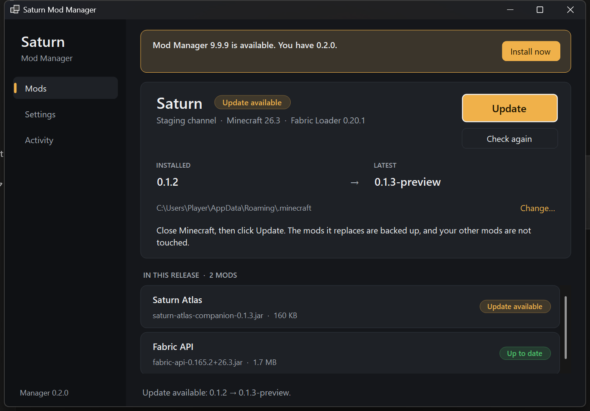
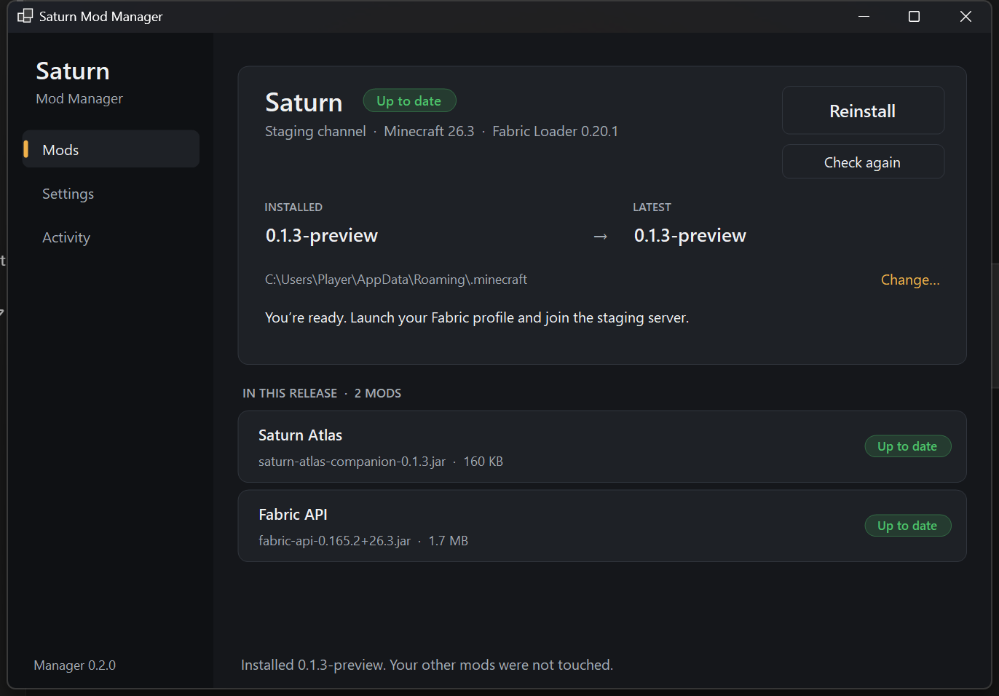

# Saturn Mod Manager (Windows x64)
One portable EXE. It keeps the Saturn mods in your Fabric profile current and keeps itself current.

1. Install Fabric Loader 0.20.1 for Minecraft Java 26.3 once.
2. Run `Saturn-Mod-Manager.exe`. It checks for releases when it opens.
3. If the folder shown is not your Fabric profile's game directory, click **Change…** and pick it.
4. Close Minecraft and click **Install** (or **Update**). One click; no confirmation.
5. Launch the same Fabric profile. **M** opens/closes the Atlas; the minimap is at top right.

Screenshots are local captures of the offline `--ui-preview` fixtures on Windows 11 at 150%
scaling in dark mode. They are not proof of a real install.

## Layout

- **Left:** Mods, Settings and Activity pages, and the manager's own version.
- **Top of the Mods page:** pack status, the installed version beside the latest version, the game
  folder, and the one main button. The button reads Install, Update, Try again or Reinstall
  according to the state, and is de-emphasised when there is nothing to do.
- **Below:** every mod in the release with its own status: up to date, update available or not
  installed. Offline, the list shows what the folder has installed instead.
- **Settings:** game folder, release source, restore the previous mods.
- **Activity:** the timestamped log, including the reason for any failure.

The window follows the Windows light/dark app preference. A Windows contrast theme replaces every
colour with system colours. Buttons, text boxes and navigation are real Windows controls with
accessible names, so keyboard and UI Automation work; status badges always carry their meaning as
text, not only as colour.

## What it changes, and what it never touches

Default source: `https://raw.githubusercontent.com/Zigdon7/MooreMinecraft/main/releases/production/pack.json`.
The live-testing manifest pins exact public GitHub release tags/assets, sizes, SHA-256 hashes and Fabric
mod IDs. From a pack manifest the manager installs JARs only. It does not install Minecraft, change
accounts or worlds, or replace the launcher.

Updates download and verify before changing mods. Existing manually installed versions are migrated
only when their declared Fabric IDs match a managed mod. Unrelated mods remain untouched. Managed
local edits and unexpected filename collisions are refused. Backups and a journal support rollback
and interrupted-install recovery. **Settings → Restore previous mods** puts back the previous
managed mod set. If Minecraft is running, the install stops before changing anything.

## Updating the manager itself

When a newer manager is published, a bar appears at the top of the window with **Install now**.
One click downloads the new EXE, verifies it, swaps it in and restarts the manager.

- The manager's release is read from the `windows-updater` entry of a **fixed** feed,
  `releases/staging/components.json` on `main` of this repository. The feed address is compiled in:
  the pack manifest and the Release source setting cannot change it.
- The entry must pin a version, size and SHA-256, and its download must be exactly
  `https://github.com/Zigdon7/MooreMinecraft/releases/download/<tag>/Saturn-Mod-Manager.exe`.
  Anything else is rejected.
- Only a strictly higher `major.minor.patch` version is offered. The feed cannot downgrade.
- The download is checked against the pinned size and hash before the running program is touched.
  The previous EXE is kept as `.old` until the new one has started, then removed.
- The EXE is unsigned. Its integrity rests on HTTPS to GitHub plus the pinned hash in this
  repository, so publishing a `windows-updater` entry is a release action: upload the asset first,
  then update `components.json` with its exact size and SHA-256.
- 0.1.6 and earlier cannot update themselves. Download 0.2.0 once by hand.

The EXE is self-contained (no separate .NET installation required) and must be in a folder you
can write to, such as Downloads or the Desktop, for the self-update to work.

## Developer checks
`dotnet run --project Tests/Saturn.Manager.Tests.csproj`

`dotnet publish Windows/Saturn.ModManager.csproj -c Release -r win-x64 --self-contained -o publish/win-x64`

`scripts/windows-smoke.ps1` (from the repository root, after publishing to `artifacts/manager`)
drives the native window through 18 offline fixtures: every state, both extra pages, keyboard-only
navigation, UI Automation page switching from a separate MTA client, the minimum window size and
150% text. It checks that the named controls exist and are inside the window.

`--ui-preview <state>` is an **offline developer fixture**, not a normal mode. States: `initial`,
`checked`, `busy`, `success`, `error`, `offline`, `manager`, `settings`, `activity`; modifiers
`--narrow`, `--large-text`, `--long-values`. Fixtures do not fetch or modify anything. They are not
proof of Narrator behaviour, real desktop DPI scaling or a real install. Earlier review history is
in [docs/DESIGN-REVIEW.md](docs/DESIGN-REVIEW.md).

## 0.2.0

- **Redesign.** Launcher-style layout described above, replacing the single scrolling form.
- **One-click install.** Install/Update no longer asks for confirmation. Restore still does.
- **Self-update.** Described above. Verified locally on Windows 11: a build labelled 0.1.5 offered
  the published 0.1.6, and one click left the EXE byte-identical to the published asset
  (SHA-256 `5ad63c13…77aacd`) and restarted into it.
- **Folder picker.** “Change…” on the Mods page opens the picker directly. The picker is still not
  driven by CI.
- Carried over from 0.1.6: STA UI thread (asserted in CI with `--check-apartment`), check on
  launch, per-mod comparison by file hash.
