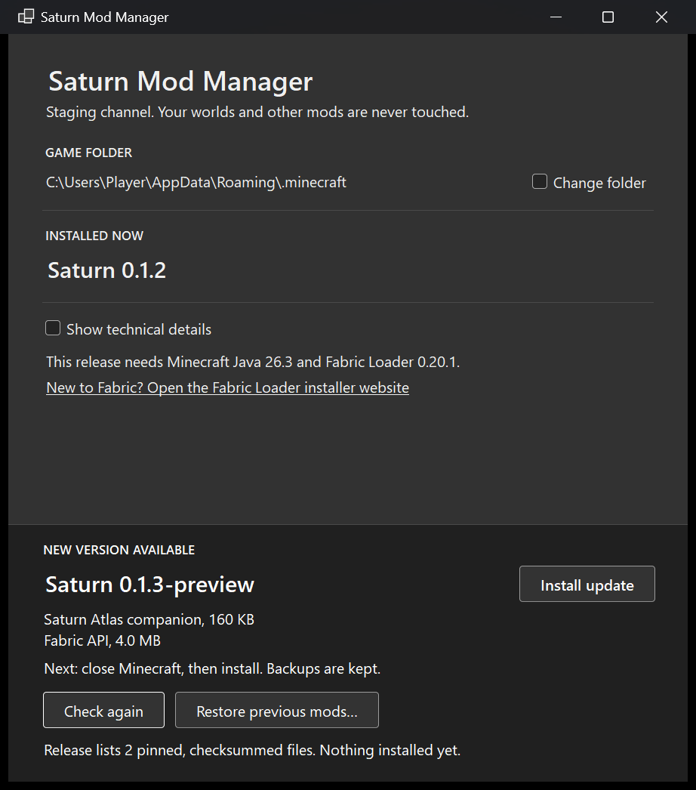
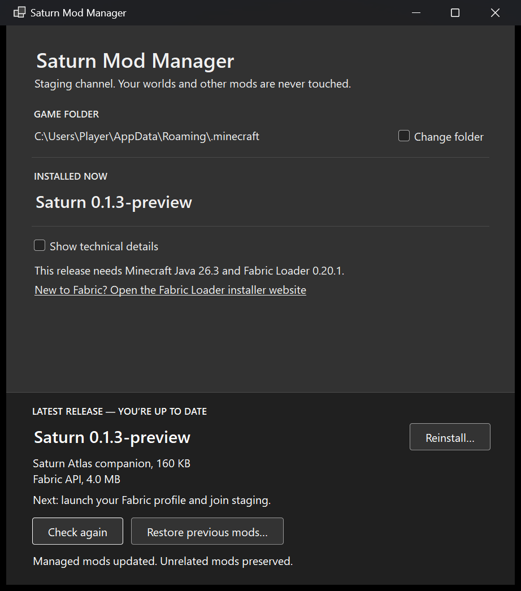

# Saturn Mod Manager (Windows x64)
One-time portable EXE; subsequent mod updates are selected in the manager, not by unpacking ZIPs.

1. Install Fabric Loader 0.20.1 for Minecraft Java 26.3 once.
2. Run `Saturn-Mod-Manager.exe`, select the game directory used by that Fabric profile.
3. **Check for updates**, review the target versions, then close Minecraft and choose **Install update**.
4. Launch the same Fabric profile. **M** opens/closes the Atlas; the minimap is at top right.

Default source: `https://raw.githubusercontent.com/Zigdon7/MooreMinecraft/main/releases/staging/pack.json`.
Technical details (including the manifest URL, exact files and operation log) are collapsed by default. The staging manifest pins exact public GitHub release tags/assets, sizes, SHA-256 hashes and Fabric mod IDs. This manager installs JARs only; it does not download/run an executable from a pack manifest, install Minecraft, change accounts/worlds, or replace the launcher.

Updates download and verify before changing mods. Existing manually installed versions are migrated only when their declared Fabric IDs match a managed mod. Unrelated mods remain untouched. Managed local edits and unexpected filename collisions are refused. Backups and a journal support rollback and interrupted-install recovery. Close Minecraft before updating. **Roll back last update** restores the previous managed mod set.

The EXE is unsigned and self-contained (no separate .NET installation required). CI checks native Windows startup; filesystem/update behavior is exercised by isolated regression tests. Real user installation still needs testing before stable release.

## Developer checks
`dotnet run --project Tests/Saturn.Manager.Tests.csproj`

`dotnet publish Windows/Saturn.ModManager.csproj -c Release -r win-x64 --self-contained -o publish/win-x64`

## UI review and accessibility evidence

The manager follows the Windows light/dark app preference through .NET 10 system color mode,
uses native button rendering (no fixed brand fill), and refreshes card/text/link colors
when system colors change. High-contrast palettes take precedence. Native CI captures
both the default runner preference and a dark Windows app preference.

The redesign uses native Windows controls/system colors, explicit accessible labels,
keyboard mnemonics and live status. Install/status stay visible while setup/details
scroll. Folder editing and technical details are tested with keyboard navigation and
an isolated MTA UI Automation client, including expand/collapse transitions.

CI captures initial, ready, busy, success, retry, details, narrow and 150%-font
fixtures. `--ui-preview <state>` is an **offline developer fixture**, not a normal
installation mode. Fixtures do not fetch or modify game files. Actual Narrator,
contrast themes and desktop DPI still require interactive acceptance; fixture
font enlargement is not desktop-DPI proof. See [review evidence](docs/DESIGN-REVIEW.md).

## 0.1.6

- **Browse fix.** The UI thread now starts in a single-threaded apartment (`[STAThread]`).
  0.1.5 and earlier started it in the MTA, which the Windows folder picker does not support;
  Windows logged the result as an application hang after Browse. CI asserts the apartment with
  `--check-apartment`. The picker itself is not driven by CI.
- **Checks on launch.** The manager reads the pack manifest when it opens. Nothing is installed
  by a check, and a failed launch check only updates the status line.
- **Installed against latest.** The game folder is compared with the checked release by file
  hash: each mod is reported as up to date, update available or not installed, and a recorded
  file missing from `mods` is called out. The comparison only reads.
- **Layout.** The installed version is the large line in the middle of the page; the latest
  release sits in the footer on the same line as the Install button, with Check and Restore below.

Screenshots below are local captures of the offline `--ui-preview` fixtures on Windows 11
at 150% scaling in dark mode. They are not CI evidence and not proof of a real install.

